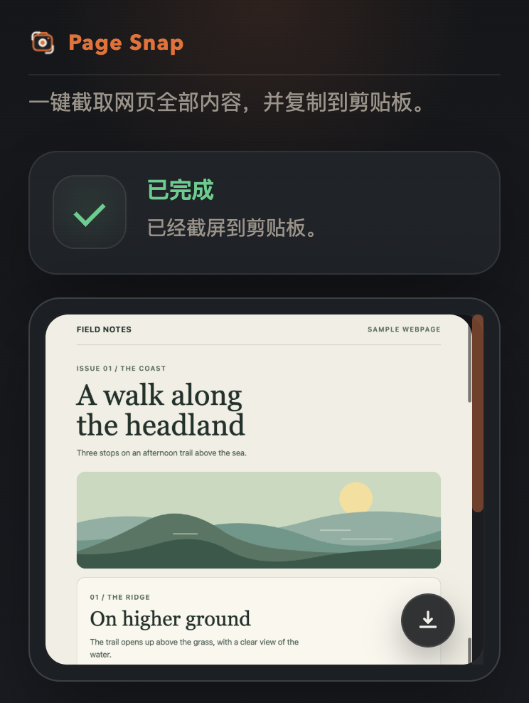

# PageSnap

PageSnap 是一个 Chrome 扩展。点击工具栏图标，即可把当前网页的可滚动内容拼成一张 PNG 长图，并自动复制到剪贴板。适合分享长文、记录网页问题，或把完整的页面状态贴进聊天和文档。

**PageSnap 已在 Chrome 网上应用店发布。**

安装地址

<https://chromewebstore.google.com/detail/pagesnap/ncelpoepimdjddgabjnfaefockakbogb?hl=zh-CN&utm_source=ext_sidebar>

## 使用方法

1. 安装后，在 Chrome 工具栏的扩展程序菜单中把 PageSnap 固定到工具栏。
2. 打开要截取的网页，点击 **PageSnap** 图标。页面会自动滚动，请等待弹窗显示 **已完成**。
3. 按 `Cmd+V`（macOS）或 `Ctrl+V`（Windows、Linux），将图片粘贴到支持图片的聊天、文档或编辑器。要保存文件，点击弹窗预览右下角的下载图标。

扩展支持部分带独立滚动区域的页面，截图时会尽量避免重复出现固定栏或吸顶栏。截图、拼接和复制都在浏览器本地完成。Chrome 内置页面（如 `chrome://extensions`）和 Chrome 网上应用店页面受浏览器限制。超长页面耗时会更久，持续加载或变化的内容可能影响拼接效果。

## 从源码安装

1. 克隆本仓库，或通过 GitHub 的 **Code → Download ZIP** 下载并解压。
2. 在 Chrome 地址栏打开 `chrome://extensions`，启用 **开发者模式**。
3. 点击 **加载已解压的扩展程序**，选择包含 `manifest.json` 的 PageSnap 目录。源码可直接加载，无需安装依赖或构建。
